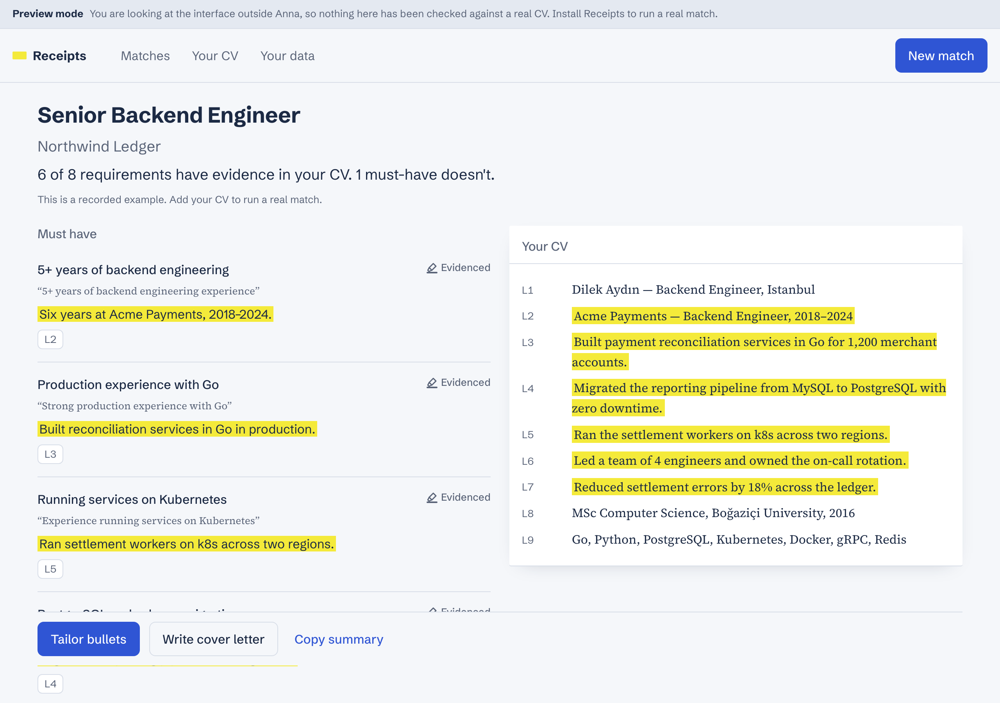

# Receipts

**Tailor every application. Invent nothing.**

Receipts is an [Anna](https://anna.partners) app. Paste a job posting and it
checks every requirement against your real CV, shows you the evidence line by
line, then writes tailored bullets and a cover letter using only facts your CV
can prove.

The name is the promise: *show me the receipts.*



---

## Why it exists

Most AI resume tools improve a CV by inventing experience — a percentage you
never hit, a tool you never used, a team you never led. It reads well and it
surfaces in the interview.

Receipts refuses. Every generated sentence is checked by a deterministic
verifier against the exact CV lines it was built from. A number, tool,
employer, date or job title that is not in your CV never reaches the page. If a
line cannot be strengthened honestly, you are told so:

> We couldn't strengthen this line without adding facts that aren't in your CV.

That is the product. The rest is how it is built.

## How it works

```
 posting ─┐
          ├─► extract requirements ──► match against numbered CV lines ──► guard citations ──► match map
 CV ──────┘         (LLM #1)                     (LLM #2)                  (pure Python)
                                                                                │
                                        tailor bullets ──► verify ──► repair ──► drop
                                        cover letter   ──► verify ──► repair ──► drop
```

Three ideas carry the whole design:

1. **The model never sees prose it can cite loosely.** The CV goes over as
   `L12: Built payment reconciliation services`, and the model answers with
   ids. The engine then checks that every cited id exists — a hallucinated
   citation downgrades the status instead of quietly standing in for evidence.

2. **Generated text is checked, not trusted.** `verify/grounding.py` extracts
   *claims* — numbers, dates, durations, technologies, proper nouns, job titles
   — and looks for each one in the normalised union of the cited CV lines.
   Rewording is free; facts are not.

3. **A failed run is never a successful one.** An empty requirement list is an
   error with a message, not a blank screen that counts as a use.

### The verifier

The heart of the product, and the part with the most tests
([`tests/verify/test_grounding.py`](tests/verify/test_grounding.py), 59 cases).

| Claim | Supported when |
|---|---|
| Number | the same numeric value appears in the source — `1,000` = `1000` = `1k` |
| Date | the year or month name appears in the source |
| Duration | the same number and unit, **or** derivable from the CV's own date ranges — "5+ years" is honest when the dates add up |
| Technology | the canonical term appears, through a synonym table (`k8s` ↔ `kubernetes`, `JS` ↔ `javascript`) |
| Proper noun | it appears in the source — or, for a general concept that is not a technology, in the posting's own wording |
| Title | it appears in the source; "Senior" is not a free upgrade |

Turkish and English are both first-class: normalisation folds `İ`, `I` and `ı`
together so `İstanbul`, `Istanbul` and `ISTANBUL` compare equal.

Failing output gets **one** repair attempt with the offending tokens named. If
it still fails, it is dropped and the user is told why.

## Architecture

| Piece | What it is |
|---|---|
| `executas/receipts-engine/` | Python 3.12 Executa plugin — JSON-RPC 2.0 over stdio. Parsing, prompting, verification, DOCX. |
| `executas/receipts-coach/` | A Skill: tells Anna to open the window instead of answering in chat. |
| `ui/` | Vite + Preact + TypeScript. Source. |
| `bundle/` | Build output. Never edited by hand. |
| `manifest.json` | Anna App manifest, schema 2. |
| `docs/api-notes.md` | Every host API signature, verified against the live docs. |

**No external services and no API keys.** The model is borrowed from the host
through reverse sampling (`sampling/createMessage`); storage, page fetch and
file download all go through Anna's host API. There is nothing to leak and
nothing to go down.

**Your CV stays yours.** It lives in your Anna account storage, is never
logged, and "Delete all my data" removes it and every match in one step.

## Running it

```bash
pnpm install
pnpm build                  # ui → bundle
anna-app dev                # harness at http://localhost:5180
anna-app dev --llm          # with real sampling (needs `anna-app login`)
```

Outside the harness the bundle falls back to **preview mode**: a recorded
example, a visible banner, and no model call. `pnpm --dir ui dev` is enough for
design work.

### Checks

```bash
pnpm check                  # typecheck + bundle tests + engine tests + validate
pnpm test                   # vitest: i18n parity, routes, ACL, engine client
pnpm test:engine            # pytest: 187 cases
pnpm lint:engine            # ruff + mypy --strict
pnpm validate               # anna-app validate --strict
node scripts/screenshots.mjs  # 360 px and 1280 px, light and dark
python scripts/eval_match.py fixtures/golden   # match quality against the golden set
```

### Publishing

Tool ids are minted server-side. The manifest references the engine by handle
(`bundled:receipts-engine`) and `anna-app apps publish` substitutes the minted
id everywhere, including the `bundle/anna-tool-ids.js` sidecar the UI reads. To
pin an id by hand:

```bash
python scripts/set-tool-id.py apply --tool tool-<handle>-receipts-engine-<uniq>
python scripts/set-tool-id.py status
```

## Documentation

| File | What is in it |
|---|---|
| [`prd.md`](prd.md) | Scope, personas, acceptance criteria, metrics |
| [`plan.md`](plan.md) | Architecture decisions, test strategy, timeline, growth |
| [`docs.md`](docs.md) | Tool contract, schemas, prompts, verifier algorithm, design system, every string |
| [`phases.md`](phases.md) | The task list, checked off as it goes |
| [`docs/api-notes.md`](docs/api-notes.md) | Verified host API signatures, and the decisions forced by them |

## Design

The direction is a recruiter's desk: cool blue-grey paper, navy ink, pencil
blue for interaction, and exactly one bold element — the highlighter mark that
shows where the evidence is. Yellow appears nowhere else.

Status never depends on colour alone: **Evidenced** is a full mark,
**Related** is an underline, **No evidence yet** is the requirement in empty
brackets. Each carries its own word.

Typefaces do one job each — Schibsted Grotesk is the app, Source Serif 4 is the
document. Both are self-hosted and subset to Latin plus Turkish (172 KB total).

## Privacy

- Your CV is stored only in your Anna account storage (`scope=app`).
- No CV content is ever written to a log; the plugin logs codes and counts.
- No external service is contacted. No API keys exist anywhere in this repo.
- Delete everything from **Your data** — CV and every saved match, in one step.

## License

MIT — see [LICENSE](LICENSE).
