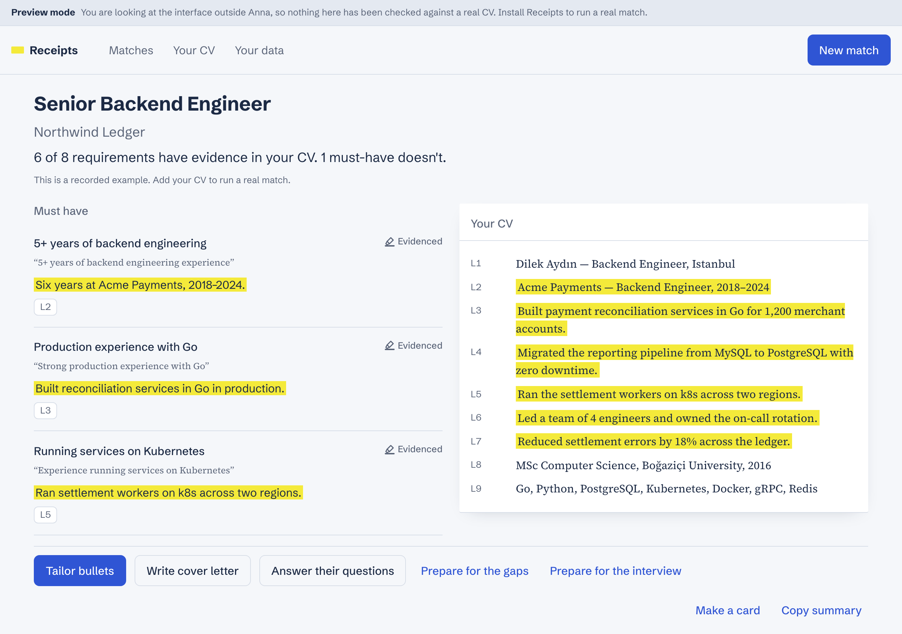

# Receipts

**Tailor every application. Invent nothing.**

Receipts is an [Anna](https://anna.partners) App. Paste a job posting and it
checks every requirement against your real CV, shows the CV line behind each
verdict, and writes tailored bullets and a cover letter that use only facts your
CV already contains. A deterministic verifier reads every generated sentence
before you see it; anything it cannot trace back to your CV is dropped, not
softened.



## Why

Most AI resume tools improve a CV by inventing experience: metrics nobody hit,
tools nobody used. It works until the interview. Receipts takes the opposite
bet — a number, tool, employer or title that is not in your CV never reaches the
page — and turns the gaps into questions only you can answer, in your own words.

## What it does

| | |
|---|---|
| **Match** | Pulls every requirement out of a posting and marks it *Evidenced*, *Related* or *No evidence yet*, each citing CV lines. |
| **Tailor and letter** | Rewrites bullets and writes a cover letter, every sentence verified against the CV. |
| **Gaps** | Asks what the CV cannot prove. Your answer becomes a CV line, stored exactly as you typed it. |
| **Check a document** | Reads a CV or letter written elsewhere against your CV and quotes back what it cannot back up. No model call. |
| **Form answers** | Answers an application form's free-text questions from the CV, and refuses the ones a CV cannot answer. |
| **Interview brief** | What you will be pressed on, and the line behind every sentence you sent. |
| **Tracker** | Every application, its status, what changed between runs, and which old applications a new line would improve. |
| **Share a card** | A 1200×630 image built from counts alone — no CV line, employer or posting wording can reach it. |

English and Turkish. Desktop and mobile (360 px and up). Light and dark.

## How "invent nothing" is enforced

1. The CV is split into numbered lines. The model sees `L12: …` and must answer
   with line ids; the engine rejects ids that do not exist.
2. Every model reply is parsed into a strict Pydantic schema (`extra="forbid"`).
3. `verify/grounding.py` checks every generated sentence: numbers, technologies,
   employers and titles must appear in the lines it cites. The posting may lend
   *concepts*, never facts about you.
4. Even the verdict is guarded: an *Evidenced* requirement that names a
   technology must cite a line containing it, or it is repaired or downgraded.
5. `pnpm eval:adversarial` runs every generator against a sampler that tries to
   fabricate, and fails the build on a single leaked claim.

The full design is in [`docs/docs.md §6`](docs/docs.md).

## Architecture

```
ui/                      Preact + TypeScript bundle (the app window)
executas/receipts-engine Python Executa plugin: parse, match, generate, verify
executas/receipts-coach  Anna Skill: opens the app from chat with a posting
tests/                   pytest (engine) and vitest (bundle)
fixtures/                golden set for eval, recorded harness sessions
docs/                    PRD, plan, technical spec, privacy page
```

There is no server, no API key and no external service. The model is reached
through Anna's sampling channel, data lives in the user's Anna storage, and
posting links are fetched by the host. See [`docs/plan.md`](docs/plan.md).

## Running it

Requirements: Node 20+, pnpm, Python 3.12, [uv](https://docs.astral.sh/uv/).

```bash
pnpm install && pnpm --dir ui install
pnpm --dir ui dev                  # the UI alone, answered by a local stub
pnpm build && npx anna-app dev     # the full app in the local Anna harness
```

Real model sampling in the harness needs an Anna account (`anna-app login`);
`anna-app dev --mock-llm fixtures/happy-path.jsonl` replays a recorded session
instead.

## Checks

```bash
pnpm check              # typecheck, bundle tests, engine tests, validate --strict
pnpm lint:engine        # ruff + mypy --strict
pnpm eval:adversarial   # fabrication gate, offline
pnpm a11y && pnpm type  # contrast, focus, tap targets; the type system
```

## Privacy

Your CV and applications live only in your Anna account storage. Uploaded files
are held in memory for one parse. CV content is never logged or sent anywhere
but Anna, and *Delete all my data* removes it in one step. Details in
[`docs/privacy.md`](docs/privacy.md).

## License

[MIT](LICENSE)
